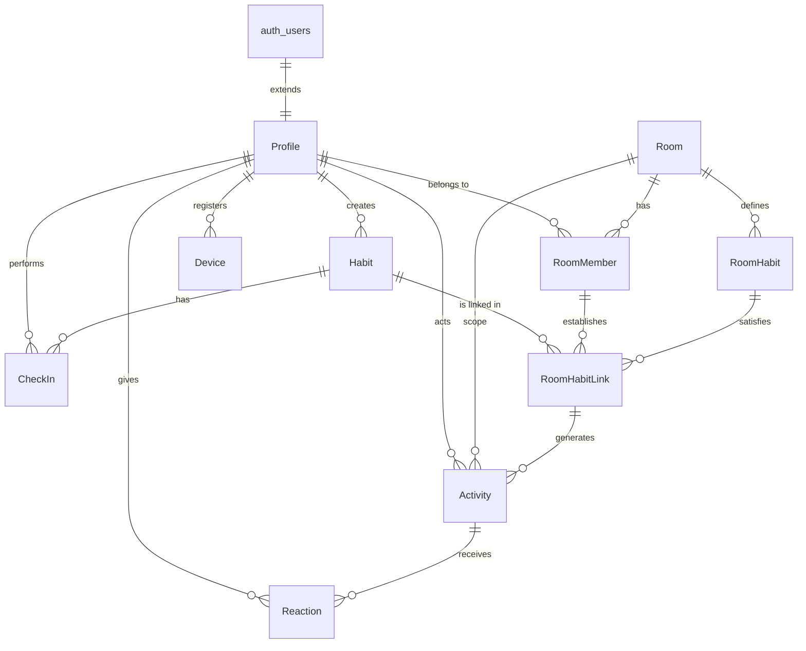

# Data Model Spec

All tables are implemented in **PostgreSQL** hosted on **Supabase** (projects `streak-dev` and `streak-prod`) and accessed directly using the Supabase Client SDK or via Edge Functions and RPC database functions.

Every table has Row Level Security (RLS) enabled.

All tables use UUIDs for primary keys. Timestamps are stored in UTC.



---

## Tables

### 1. Profiles
Extends Supabase's built-in `auth.users` table.

```sql
CREATE TABLE public.profiles (
  id UUID PRIMARY KEY REFERENCES auth.users(id) ON DELETE CASCADE,
  username VARCHAR(100) UNIQUE,
  display_name VARCHAR(255) NOT NULL,
  avatar_url TEXT,
  bio TEXT,
  timezone VARCHAR(100) NOT NULL DEFAULT 'UTC', -- IANA string (e.g. 'Asia/Kolkata')
  locale VARCHAR(10) NOT NULL DEFAULT 'en',
  xp INTEGER NOT NULL DEFAULT 0 CHECK (xp >= 0),
  level INTEGER NOT NULL DEFAULT 1 CHECK (level >= 1),
  onboarding_completed_at TIMESTAMP WITH TIME ZONE,
  created_at TIMESTAMP WITH TIME ZONE NOT NULL DEFAULT NOW(),
  updated_at TIMESTAMP WITH TIME ZONE NOT NULL DEFAULT NOW()
);

-- RLS Policies:
-- 1. Profiles are readable by anyone (for social search and feeds).
-- 2. Profiles can only be updated by their owner (id = auth.uid()).
```

### 2. Habit
```sql
CREATE TYPE habit_status AS ENUM ('ACTIVE', 'ARCHIVED', 'PAUSED');
CREATE TYPE schedule_type AS ENUM ('DAILY', 'SPECIFIC_DAYS', 'FLEXIBLE');

CREATE TABLE public.habits (
  id UUID PRIMARY KEY DEFAULT gen_random_uuid(),
  profile_id UUID NOT NULL REFERENCES public.profiles(id) ON DELETE CASCADE,
  name VARCHAR(255) NOT NULL,
  description TEXT,
  icon VARCHAR(50),
  status habit_status NOT NULL DEFAULT 'ACTIVE',
  schedule_type schedule_type NOT NULL DEFAULT 'DAILY',
  target_per_week INTEGER CHECK (target_per_week BETWEEN 1 AND 7), -- Used if schedule_type = 'FLEXIBLE'
  timezone VARCHAR(100) NOT NULL, -- Snapshot of timezone when created
  start_date DATE NOT NULL,
  archived_at TIMESTAMP WITH TIME ZONE,
  created_at TIMESTAMP WITH TIME ZONE NOT NULL DEFAULT NOW(),
  updated_at TIMESTAMP WITH TIME ZONE NOT NULL DEFAULT NOW()
);

CREATE INDEX idx_habits_profile ON public.habits(profile_id);

-- RLS Policies:
-- 1. Owner CRUD only (profile_id = auth.uid()).
```

### 3. HabitScheduleDay
Required if `schedule_type = 'SPECIFIC_DAYS'`.
```sql
CREATE TABLE public.habit_schedule_days (
  id UUID PRIMARY KEY DEFAULT gen_random_uuid(),
  habit_id UUID NOT NULL REFERENCES public.habits(id) ON DELETE CASCADE,
  day_of_week INTEGER NOT NULL CHECK (day_of_week BETWEEN 0 AND 6), -- 0 = Sunday, 6 = Saturday
  UNIQUE(habit_id, day_of_week)
);

-- RLS Policies:
-- 1. Inherits owner authorization from habits table.
```

### 4. CheckIn
Represents completion of a habit.
```sql
CREATE TABLE public.check_ins (
  id UUID PRIMARY KEY DEFAULT gen_random_uuid(),
  profile_id UUID NOT NULL REFERENCES public.profiles(id) ON DELETE CASCADE,
  habit_id UUID NOT NULL REFERENCES public.habits(id) ON DELETE CASCADE,
  local_date DATE NOT NULL, -- The user's habit day (YYYY-MM-DD)
  completed_at_utc TIMESTAMP WITH TIME ZONE NOT NULL,
  timezone_at_completion VARCHAR(100) NOT NULL,
  source VARCHAR(50) NOT NULL DEFAULT 'mobile', -- 'mobile', 'web'
  idempotency_key VARCHAR(255) UNIQUE NOT NULL, -- Format: profileId:habitId:localDate
  created_at TIMESTAMP WITH TIME ZONE NOT NULL DEFAULT NOW()
);

CREATE INDEX idx_check_ins_habit_date ON public.check_ins(habit_id, local_date);
CREATE INDEX idx_check_ins_profile_date ON public.check_ins(profile_id, local_date);

-- RLS Policies:
-- 1. Owner CRUD only (profile_id = auth.uid()).
```

### 5. HabitStats
Materialized statistics for performance. Recalculated on check-in mutations via PostgreSQL functions.
```sql
CREATE TABLE public.habit_stats (
  habit_id UUID PRIMARY KEY REFERENCES public.habits(id) ON DELETE CASCADE,
  current_streak INTEGER NOT NULL DEFAULT 0 CHECK (current_streak >= 0),
  best_streak INTEGER NOT NULL DEFAULT 0 CHECK (best_streak >= 0),
  total_completions INTEGER NOT NULL DEFAULT 0 CHECK (total_completions >= 0),
  completion_rate NUMERIC(5,2) NOT NULL DEFAULT 0.00,
  recalculated_at TIMESTAMP WITH TIME ZONE NOT NULL DEFAULT NOW()
);

-- RLS Policies:
-- 1. Owner CRUD only (joined on habits.profile_id = auth.uid()).
```

### 6. Room
```sql
CREATE TYPE room_visibility AS ENUM ('PUBLIC', 'PRIVATE');

CREATE TABLE public.rooms (
  id UUID PRIMARY KEY DEFAULT gen_random_uuid(),
  owner_id UUID NOT NULL REFERENCES public.profiles(id) ON DELETE RESTRICT,
  name VARCHAR(255) NOT NULL,
  description TEXT,
  image_url TEXT,
  visibility room_visibility NOT NULL DEFAULT 'PRIVATE',
  invite_code VARCHAR(50) UNIQUE,
  created_at TIMESTAMP WITH TIME ZONE NOT NULL DEFAULT NOW(),
  updated_at TIMESTAMP WITH TIME ZONE NOT NULL DEFAULT NOW(),
  archived_at TIMESTAMP WITH TIME ZONE
);

-- RLS Policies:
-- 1. Public rooms readable by anyone; private rooms readable only by room members.
```

### 7. RoomMember
```sql
CREATE TYPE room_role AS ENUM ('OWNER', 'ADMIN', 'MEMBER');

CREATE TABLE public.room_members (
  id UUID PRIMARY KEY DEFAULT gen_random_uuid(),
  room_id UUID NOT NULL REFERENCES public.rooms(id) ON DELETE CASCADE,
  profile_id UUID NOT NULL REFERENCES public.profiles(id) ON DELETE CASCADE,
  role room_role NOT NULL DEFAULT 'MEMBER',
  joined_at TIMESTAMP WITH TIME ZONE NOT NULL DEFAULT NOW(),
  left_at TIMESTAMP WITH TIME ZONE
);

CREATE UNIQUE INDEX idx_active_room_member ON public.room_members (room_id, profile_id) WHERE left_at IS NULL;
CREATE INDEX idx_room_members_profile ON public.room_members(profile_id);

-- RLS Policies:
-- 1. Room members can view other members.
```

### 8. RoomHabit
Represents an accountability target defined by the room owner/admin.
```sql
CREATE TABLE public.room_habits (
  id UUID PRIMARY KEY DEFAULT gen_random_uuid(),
  room_id UUID NOT NULL REFERENCES public.rooms(id) ON DELETE CASCADE,
  name VARCHAR(255) NOT NULL,
  description TEXT,
  archived_at TIMESTAMP WITH TIME ZONE, -- NULL = active
  created_at TIMESTAMP WITH TIME ZONE NOT NULL DEFAULT NOW(),
  updated_at TIMESTAMP WITH TIME ZONE NOT NULL DEFAULT NOW()
);

CREATE INDEX idx_room_habits_room ON public.room_habits(room_id);

-- RLS Policies:
-- 1. Read access to room members.
-- 2. Modify access to room OWNER/ADMIN only.
```

### 9. RoomHabitLink
Represents a member's opt-in to link their personal habit to a Room Habit.
```sql
CREATE TABLE public.room_habit_links (
  id UUID PRIMARY KEY DEFAULT gen_random_uuid(),
  room_member_id UUID NOT NULL REFERENCES public.room_members(id) ON DELETE CASCADE,
  room_habit_id UUID NOT NULL REFERENCES public.room_habits(id) ON DELETE CASCADE,
  personal_habit_id UUID NOT NULL REFERENCES public.habits(id) ON DELETE CASCADE,
  linked_at TIMESTAMP WITH TIME ZONE NOT NULL DEFAULT NOW(),
  unlinked_at TIMESTAMP WITH TIME ZONE -- NULL = active
);

-- Constraints
CREATE UNIQUE INDEX idx_active_room_habit_link 
  ON public.room_habit_links (room_member_id, room_habit_id) 
  WHERE unlinked_at IS NULL;

CREATE UNIQUE INDEX idx_active_personal_habit_link 
  ON public.room_habit_links (room_member_id, personal_habit_id) 
  WHERE unlinked_at IS NULL;

CREATE INDEX idx_room_habit_links_member ON public.room_habit_links(room_member_id);

-- RLS Policies:
-- 1. Read access to room members.
-- 2. Insert/Delete access only to the matching room_member_id's owner.
```

### 10. Activity
```sql
CREATE TYPE activity_type AS ENUM ('HABIT_COMPLETED', 'STREAK_MILESTONE', 'PERSONAL_BEST', 'ROOM_JOIN', 'LEVEL_UP');

CREATE TABLE public.activities (
  id UUID PRIMARY KEY DEFAULT gen_random_uuid(),
  actor_profile_id UUID NOT NULL REFERENCES public.profiles(id) ON DELETE CASCADE,
  room_id UUID REFERENCES public.rooms(id) ON DELETE CASCADE, -- Scopes feed to a specific Room
  room_habit_link_id UUID REFERENCES public.room_habit_links(id) ON DELETE SET NULL,
  type activity_type NOT NULL,
  message VARCHAR(500) NOT NULL,
  metadata_json JSONB,
  visibility room_visibility NOT NULL DEFAULT 'PRIVATE',
  deduplication_key VARCHAR(255) UNIQUE, -- Format: profileId:habitId:localDate:roomId
  created_at TIMESTAMP WITH TIME ZONE NOT NULL DEFAULT NOW()
);

CREATE INDEX idx_activities_room ON public.activities(room_id, created_at DESC) WHERE room_id IS NOT NULL;

-- RLS Policies:
-- 1. Members of the room (room_id) can read activities. Global activities (room_id IS NULL) are readable by all.
```

### 11. Reaction
```sql
CREATE TABLE public.reactions (
  id UUID PRIMARY KEY DEFAULT gen_random_uuid(),
  activity_id UUID NOT NULL REFERENCES public.activities(id) ON DELETE CASCADE,
  profile_id UUID NOT NULL REFERENCES public.profiles(id) ON DELETE CASCADE,
  type VARCHAR(50) NOT NULL, -- e.g., 'clap', 'fire', 'heart'
  created_at TIMESTAMP WITH TIME ZONE NOT NULL DEFAULT NOW(),
  UNIQUE(activity_id, profile_id, type)
);

-- RLS Policies:
-- 1. Members of the activity's room can read reactions.
-- 2. Any room member can create a reaction; only the owner (profile_id = auth.uid()) can delete it.
```

### 12. Device
```sql
CREATE TABLE public.devices (
  id UUID PRIMARY KEY DEFAULT gen_random_uuid(),
  profile_id UUID NOT NULL REFERENCES public.profiles(id) ON DELETE CASCADE,
  platform VARCHAR(50) NOT NULL, -- 'android', 'ios'
  push_token TEXT NOT NULL,
  token_status VARCHAR(50) NOT NULL DEFAULT 'ACTIVE',
  app_version VARCHAR(50),
  last_seen_at TIMESTAMP WITH TIME ZONE NOT NULL DEFAULT NOW(),
  created_at TIMESTAMP WITH TIME ZONE NOT NULL DEFAULT NOW(),
  updated_at TIMESTAMP WITH TIME ZONE NOT NULL DEFAULT NOW(),
  UNIQUE(profile_id, push_token)
);

-- RLS Policies:
-- 1. Owner CRUD only (profile_id = auth.uid()).
```
