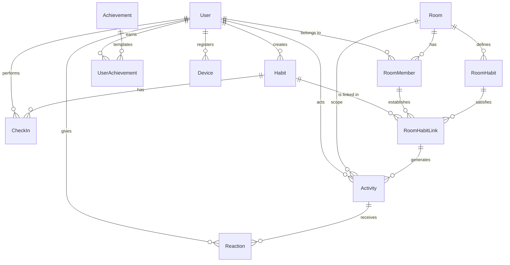

# Data Model Spec

All tables are implemented in **PostgreSQL** (hosted on **Supabase** as the managed database platform), and queried/mutated using **Prisma** as the database access layer/ORM.
All tables use UUIDs for primary keys. Timestamps are stored in UTC.



## Tables

### 1. User
```sql
CREATE TABLE users (
  id UUID PRIMARY KEY DEFAULT gen_random_uuid(),
  auth_user_id VARCHAR(255) UNIQUE NOT NULL, -- Links to Supabase Auth
  email VARCHAR(255) UNIQUE NOT NULL,
  display_name VARCHAR(255) NOT NULL,
  username VARCHAR(100) UNIQUE,
  avatar_path TEXT,
  bio TEXT,
  timezone VARCHAR(100) NOT NULL DEFAULT 'UTC', -- IANA string (e.g. 'Asia/Kolkata')
  locale VARCHAR(10) NOT NULL DEFAULT 'en',
  xp INTEGER NOT NULL DEFAULT 0 CHECK (xp >= 0),
  level INTEGER NOT NULL DEFAULT 1 CHECK (level >= 1),
  onboarding_completed_at TIMESTAMP WITH TIME ZONE,
  created_at TIMESTAMP WITH TIME ZONE NOT NULL DEFAULT NOW(),
  updated_at TIMESTAMP WITH TIME ZONE NOT NULL DEFAULT NOW(),
  deleted_at TIMESTAMP WITH TIME ZONE
);

CREATE INDEX idx_users_username ON users(username) WHERE deleted_at IS NULL;
```

### 2. Habit
```sql
CREATE TYPE habit_status AS ENUM ('ACTIVE', 'ARCHIVED', 'PAUSED');
CREATE TYPE schedule_type AS ENUM ('DAILY', 'SPECIFIC_DAYS', 'FLEXIBLE');

CREATE TABLE habits (
  id UUID PRIMARY KEY DEFAULT gen_random_uuid(),
  user_id UUID NOT NULL REFERENCES users(id) ON DELETE CASCADE,
  name VARCHAR(255) NOT NULL,
  description TEXT,
  icon VARCHAR(50),
  status habit_status NOT NULL DEFAULT 'ACTIVE',
  schedule_type schedule_type NOT NULL DEFAULT 'DAILY',
  target_per_week INTEGER CHECK (target_per_week BETWEEN 1 AND 7), -- Used if schedule_type = 'FLEXIBLE'
  timezone VARCHAR(100) NOT NULL, -- Snapshot of timezone when created
  start_date DATE NOT NULL,
  archived_at TIMESTAMP WITH TIME ZONE,
  created_at TIMESTAMP WITH TIME ZONE NOT NULL DEFAULT NOW(),
  updated_at TIMESTAMP WITH TIME ZONE NOT NULL DEFAULT NOW()
);

CREATE INDEX idx_habits_user ON habits(user_id);
```

### 3. HabitScheduleDay
Required if `schedule_type = 'SPECIFIC_DAYS'`.
```sql
CREATE TABLE habit_schedule_days (
  id UUID PRIMARY KEY DEFAULT gen_random_uuid(),
  habit_id UUID NOT NULL REFERENCES habits(id) ON DELETE CASCADE,
  day_of_week INTEGER NOT NULL CHECK (day_of_week BETWEEN 0 AND 6), -- 0 = Sunday, 6 = Saturday
  UNIQUE(habit_id, day_of_week)
);
```

### 4. CheckIn
Represents completion of a habit.
```sql
CREATE TABLE check_ins (
  id UUID PRIMARY KEY DEFAULT gen_random_uuid(),
  user_id UUID NOT NULL REFERENCES users(id) ON DELETE CASCADE,
  habit_id UUID NOT NULL REFERENCES habits(id) ON DELETE CASCADE,
  local_date DATE NOT NULL, -- The user's habit day (YYYY-MM-DD)
  completed_at_utc TIMESTAMP WITH TIME ZONE NOT NULL,
  timezone_at_completion VARCHAR(100) NOT NULL,
  source VARCHAR(50) NOT NULL DEFAULT 'mobile', -- 'mobile', 'web'
  idempotency_key VARCHAR(255) UNIQUE NOT NULL, -- Format: userId:habitId:localDate
  created_at TIMESTAMP WITH TIME ZONE NOT NULL DEFAULT NOW()
);

CREATE INDEX idx_check_ins_habit_date ON check_ins(habit_id, local_date);
CREATE INDEX idx_check_ins_user_date ON check_ins(user_id, local_date);
```

### 5. HabitStats
Materialized statistics for performance. Recalculated on check-in mutations.
```sql
CREATE TABLE habit_stats (
  habit_id UUID PRIMARY KEY REFERENCES habits(id) ON DELETE CASCADE,
  current_streak INTEGER NOT NULL DEFAULT 0 CHECK (current_streak >= 0),
  best_streak INTEGER NOT NULL DEFAULT 0 CHECK (best_streak >= 0),
  total_completions INTEGER NOT NULL DEFAULT 0 CHECK (total_completions >= 0),
  completion_rate NUMERIC(5,2) NOT NULL DEFAULT 0.00,
  recalculated_at TIMESTAMP WITH TIME ZONE NOT NULL DEFAULT NOW()
);
```

### 6. Room
```sql
CREATE TYPE room_visibility AS ENUM ('PUBLIC', 'PRIVATE');

CREATE TABLE rooms (
  id UUID PRIMARY KEY DEFAULT gen_random_uuid(),
  owner_id UUID NOT NULL REFERENCES users(id) ON DELETE RESTRICT,
  name VARCHAR(255) NOT NULL,
  description TEXT,
  image_path TEXT,
  visibility room_visibility NOT NULL DEFAULT 'PRIVATE',
  invite_code VARCHAR(50) UNIQUE,
  created_at TIMESTAMP WITH TIME ZONE NOT NULL DEFAULT NOW(),
  updated_at TIMESTAMP WITH TIME ZONE NOT NULL DEFAULT NOW(),
  archived_at TIMESTAMP WITH TIME ZONE
);
```

### 7. RoomMember
```sql
CREATE TYPE room_role AS ENUM ('OWNER', 'ADMIN', 'MEMBER');

CREATE TABLE room_members (
  id UUID PRIMARY KEY DEFAULT gen_random_uuid(),
  room_id UUID NOT NULL REFERENCES rooms(id) ON DELETE CASCADE,
  user_id UUID NOT NULL REFERENCES users(id) ON DELETE CASCADE,
  role room_role NOT NULL DEFAULT 'MEMBER',
  joined_at TIMESTAMP WITH TIME ZONE NOT NULL DEFAULT NOW(),
  left_at TIMESTAMP WITH TIME ZONE
);

CREATE UNIQUE INDEX idx_active_room_member ON room_members (room_id, user_id) WHERE left_at IS NULL;
CREATE INDEX idx_room_members_user ON room_members(user_id);
```

### 8. RoomHabit
Represents an accountability target or room habit defined by the room owner/admin. Supports an archival lifecycle.
```sql
CREATE TABLE room_habits (
  id UUID PRIMARY KEY DEFAULT gen_random_uuid(),
  room_id UUID NOT NULL REFERENCES rooms(id) ON DELETE CASCADE,
  name VARCHAR(255) NOT NULL,
  description TEXT,
  archived_at TIMESTAMP WITH TIME ZONE, -- NULL = active, populated = archived
  created_at TIMESTAMP WITH TIME ZONE NOT NULL DEFAULT NOW(),
  updated_at TIMESTAMP WITH TIME ZONE NOT NULL DEFAULT NOW()
);

CREATE INDEX idx_room_habits_room ON room_habits(room_id);
```

### 9. RoomHabitLink
Represents a member's explicit opt-in to participate in a Room Habit by linking their personal habit. Unlinking is a soft lifecycle transition (`unlinked_at` populated), not a destructive deletion, preserving historical activity. Only the link owner can voluntarily unlink.
```sql
CREATE TABLE room_habit_links (
  id UUID PRIMARY KEY DEFAULT gen_random_uuid(),
  room_member_id UUID NOT NULL REFERENCES room_members(id) ON DELETE CASCADE,
  room_habit_id UUID NOT NULL REFERENCES room_habits(id) ON DELETE CASCADE,
  personal_habit_id UUID NOT NULL REFERENCES habits(id) ON DELETE CASCADE,
  linked_at TIMESTAMP WITH TIME ZONE NOT NULL DEFAULT NOW(),
  unlinked_at TIMESTAMP WITH TIME ZONE -- NULL = active link, populated = soft unlinked
);

-- Active RoomHabitLink uniqueness constraints:
-- 1. A member can have only one active link per room habit:
CREATE UNIQUE INDEX idx_active_room_habit_link 
  ON room_habit_links (room_member_id, room_habit_id) 
  WHERE unlinked_at IS NULL;

-- 2. A personal habit can be linked to at most one active room habit at a time:
CREATE UNIQUE INDEX idx_active_personal_habit_link 
  ON room_habit_links (room_member_id, personal_habit_id) 
  WHERE unlinked_at IS NULL;

CREATE INDEX idx_room_habit_links_member ON room_habit_links(room_member_id);
```

### 10. Activity
```sql
CREATE TYPE activity_type AS ENUM ('HABIT_COMPLETED', 'STREAK_MILESTONE', 'PERSONAL_BEST', 'ROOM_JOIN', 'LEVEL_UP');

CREATE TABLE activities (
  id UUID PRIMARY KEY DEFAULT gen_random_uuid(),
  actor_user_id UUID NOT NULL REFERENCES users(id) ON DELETE CASCADE,
  room_id UUID REFERENCES rooms(id) ON DELETE CASCADE, -- Scopes feed to a specific Room (NULL = global/personal only)
  room_habit_link_id UUID REFERENCES room_habit_links(id) ON DELETE SET NULL, -- References explicit linkage
  type activity_type NOT NULL,
  message VARCHAR(500) NOT NULL,
  metadata_json JSONB,
  visibility room_visibility NOT NULL DEFAULT 'PRIVATE', -- Derived from room visibility
  deduplication_key VARCHAR(255) UNIQUE, -- Avoids duplicate events (e.g. userId:habitId:localDate:roomId)
  created_at TIMESTAMP WITH TIME ZONE NOT NULL DEFAULT NOW()
);

CREATE INDEX idx_activities_room ON activities(room_id, created_at DESC) WHERE room_id IS NOT NULL;
```

### 11. Reaction
```sql
CREATE TABLE reactions (
  id UUID PRIMARY KEY DEFAULT gen_random_uuid(),
  activity_id UUID NOT NULL REFERENCES activities(id) ON DELETE CASCADE,
  user_id UUID NOT NULL REFERENCES users(id) ON DELETE CASCADE,
  type VARCHAR(50) NOT NULL, -- e.g. 'clap', 'fire', 'flex'
  created_at TIMESTAMP WITH TIME ZONE NOT NULL DEFAULT NOW(),
  UNIQUE(activity_id, user_id, type)
);
```

### 12. Device & NotificationDelivery
```sql
CREATE TABLE devices (
  id UUID PRIMARY KEY DEFAULT gen_random_uuid(),
  user_id UUID NOT NULL REFERENCES users(id) ON DELETE CASCADE,
  platform VARCHAR(50) NOT NULL, -- 'android', 'ios'
  push_token TEXT NOT NULL,
  token_status VARCHAR(50) NOT NULL DEFAULT 'ACTIVE',
  app_version VARCHAR(50),
  last_seen_at TIMESTAMP WITH TIME ZONE NOT NULL DEFAULT NOW(),
  created_at TIMESTAMP WITH TIME ZONE NOT NULL DEFAULT NOW(),
  updated_at TIMESTAMP WITH TIME ZONE NOT NULL DEFAULT NOW(),
  UNIQUE(user_id, push_token)
);

CREATE TABLE notification_deliveries (
  id UUID PRIMARY KEY DEFAULT gen_random_uuid(),
  user_id UUID NOT NULL REFERENCES users(id) ON DELETE CASCADE,
  device_id UUID REFERENCES devices(id) ON DELETE SET NULL,
  type VARCHAR(50) NOT NULL,
  deduplication_key VARCHAR(255) UNIQUE NOT NULL,
  scheduled_for TIMESTAMP WITH TIME ZONE,
  sent_at TIMESTAMP WITH TIME ZONE,
  status VARCHAR(50) NOT NULL DEFAULT 'PENDING',
  provider_message_id TEXT,
  failure_reason TEXT,
  created_at TIMESTAMP WITH TIME ZONE NOT NULL DEFAULT NOW()
);
```
