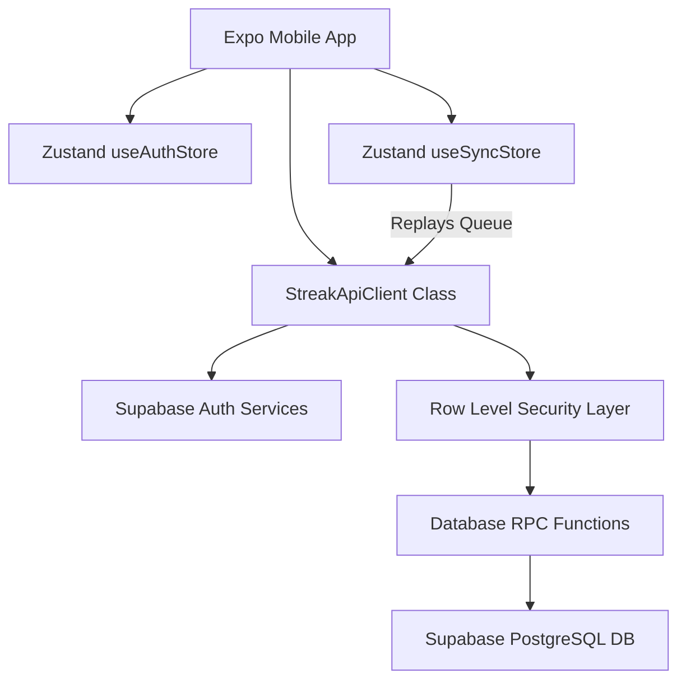

# Project Audit & Progress Analysis Report

This report presents a thorough audit of the **Final Streak** monorepo repository, conducted from the perspective of a senior technical lead. It analyzes the current architectural state, features, database schema, codebase organization, and progress.

---

## 1. Executive Summary

### 1.1 Purpose of the Project
Final Streak is a mobile accountability and habit-tracking application. Its core value proposition is driving long-term habit consistency through social accountability (accountability rooms, live leaderboards, activity feeds, and gamified leveling/XP systems).

### 1.2 Current Development Stage
The project is in a **mid-to-late development stage** (~80% overall completion).
* **Database & API Client SDK**: 100% complete and fully verified.
* **Core Offline-First Engine**: 100% complete and verified.
* **Mobile UI Screens**: ~75% complete (core screens are built, but refinement and edge cases are being integrated).
* **Notifications & Testing**: Partially implemented (~20%).

### 1.3 Architecture Overview
The project has been migrated from a legacy NestJS/Prisma REST API to a **Supabase-first serverless architecture**:
* **Backend**: Hosted PostgreSQL on Supabase. Row-Level Security (RLS) policies act as the security boundary. Transactional business logic runs inside database SQL RPC functions.
* **Frontend**: Expo (React Native SDK 56) with Expo Router for file-based navigation, NativeWind v4 for CSS styling, TanStack Query for remote state caching, and Zustand for minimal client-only states (auth, offline queues).
* **Code Sharing**: Monorepo using `pnpm` workspaces and `Turborepo` to share contracts, validation schemas, and configurations.

---

## 2. Project Structure

```
├── apps
│   └── mobile                  # Expo Mobile Application (React Native)
├── packages
│   ├── api-client              # Reusable Supabase SDK Wrapper for DB/Auth operations
│   ├── config                  # Shared ESLint, Prettier, and TypeScript configs
│   ├── contracts               # Shared TypeScript response interfaces & enums
│   ├── design-tokens           # Shared design styles and theme variables
│   ├── testing                 # Testing utilities and mocks
│   └── validation              # Zod validation schemas for inputs & DTOs
└── supabase                    # Supabase setup, schemas, RLS policies, and RPC scripts
    ├── migrations              # Production-ready SQL migrations (e.g. 0001_schema.sql)
    └── *.sql                   # SQL patches and database reset scripts
```

### Folder Responsibilities:
* **`apps/mobile`**: Houses the mobile client application (views, UI hooks, assets).
* **`packages/api-client`**: Insulates the UI from direct raw Supabase commands, exporting a structured, strongly-typed Class `StreakApiClient` to execute auth and database operations.
* **`packages/contracts`**: Serves as the single source of truth for schemas, types, and model interfaces shared across packages.
* **`packages/validation`**: Encapsulates Zod rules to validate forms/inputs client-side and parameters server-side.
* **`supabase/`**: Defines the database schema, security policies, triggers, and RPC functions.

*Note: Legacy directories `apps/api` and `apps/web` are deprecated/ignored and are completely removed from active development.*

---

## 3. Implemented Features

### 3.1 Authentication
* **What it does**: Handles user signup, login, session persistence, and logout.
* **How it works**: Uses Supabase Auth (`supabase.auth`) via a Zustand store `useAuthStore` in [auth-store.ts](file:///d:/Projects/streak/apps/mobile/src/store/auth-store.ts).
* **Important files**: [auth-store.ts](file:///d:/Projects/streak/apps/mobile/src/store/auth-store.ts), [login.tsx](file:///d:/Projects/streak/apps/mobile/app/(auth)/login.tsx), [register.tsx](file:///d:/Projects/streak/apps/mobile/app/(auth)/register.tsx)
* **Completeness**: 100%

### 3.2 User Profiles
* **What it does**: Represents public-facing user profiles, timezone settings, and gamification state (XP and Level).
* **How it works**: A database trigger `on_auth_user_created` runs `handle_new_user()` in [0001_schema.sql](file:///d:/Projects/streak/supabase/migrations/0001_schema.sql) to auto-populate the `profiles` table when a user registers. Direct reads and owner-updates are supported.
* **Important files**: [0001_schema.sql](file:///d:/Projects/streak/supabase/migrations/0001_schema.sql#L33-L50), [index.ts (api-client)](file:///d:/Projects/streak/packages/api-client/src/index.ts#L13-L73)
* **Completeness**: 95% (Needs avatar upload integration).

### 3.3 Habits
* **What it does**: Allows users to define habits with specific scheduling behaviors (`DAILY`, `SPECIFIC_DAYS`, `FLEXIBLE`).
* **How it works**: Write operations are handled via the Supabase client directly, validated by `CreateHabitSchema` from `@streak/validation`.
* **Important files**: [index.ts (validation)](file:///d:/Projects/streak/packages/validation/src/index.ts#L13-L25), [index.ts (api-client)](file:///d:/Projects/streak/packages/api-client/src/index.ts#L75-L170), [today.tsx](file:///d:/Projects/streak/apps/mobile/app/(tabs)/today.tsx)
* **Completeness**: 90%

### 3.4 Streak System & Gamification
* **What it does**: Tracks consecutive completions, recalculates stats, and increments XP (+10 per completion) and levels.
* **How it works**: Handled transactional-style inside database RPC functions `complete_habit` and `undo_complete_habit`. Supported calculations include calendar day streaks (`DAILY`), scheduled days (`SPECIFIC_DAYS`), and weekly completions (`FLEXIBLE`).
* **Important files**: [0001_schema.sql](file:///d:/Projects/streak/supabase/migrations/0001_schema.sql#L330-L800)
* **Completeness**: 100%

### 3.5 Rooms & Social Accountability
* **What it does**: Groups users in a shared space where they link personal habits to room habits, sharing a feed and leaderboard.
* **How it works**: Custom database RPCs manage room creation (`create_room`), member joins (`join_room`), leaving (`leave_room`), and leaderboard rankings (`get_leaderboard`).
* **Important files**: [patch_missing_rpcs.sql](file:///d:/Projects/streak/supabase/patch_missing_rpcs.sql), [rooms.tsx](file:///d:/Projects/streak/apps/mobile/app/(tabs)/rooms.tsx)
* **Completeness**: 85%

### 3.6 Offline Sync
* **What it does**: Enqueues habit check-ins and undo operations when offline, replaying them with Stable UUIDs and idempotency keys upon reconnection.
* **How it works**: Handled via Zustand store `useSyncStore` writing queue states into AsyncStorage.
* **Important files**: [sync-store.ts](file:///d:/Projects/streak/apps/mobile/src/store/sync-store.ts)
* **Completeness**: 100%

---

## 4. Architecture Analysis



* **Data Flow**: Direct table access via Supabase SDK is allowed for simple CRUD actions (e.g. loading habits, profiles). Any transactional, multi-table side effect must run through PostgreSQL database RPC functions.
* **State Split**: TanStack Query is used as the asynchronous data cache. Local Zustand stores are kept lean and reserved for UI-centric states (e.g., authentication status, offline mutation queue).
* **Synchronization**: On reconnection, queued transactions are popped sequentially. Duplicate completions are avoided using deterministic idempotency keys formatted as `profileId:habitId:localDate`.

---

## 5. Database Analysis (Supabase PostgreSQL)

The database schema is defined in [0001_schema.sql](file:///d:/Projects/streak/supabase/migrations/0001_schema.sql) and [patch_missing_rpcs.sql](file:///d:/Projects/streak/supabase/patch_missing_rpcs.sql).

### 5.1 Tables & Schema Details
* **`profiles`**: Extends auth users, stores username, display name, bios, timezone, and gamified stats (XP, level).
* **`habits`**: Contains details of a personal habit.
* **`habit_schedule_days`**: Links specific calendar week days (0–6) to a habit.
* **`check_ins`**: Single check-in logs. Contains a unique `idempotency_key` (e.g. `profileId:habitId:localDate`).
* **`habit_stats`**: Materialized metrics (current streak, best streak, completion rate) to avoid on-the-fly execution overhead.
* **`rooms`**: Groups users under an ownership record with private/public visibility settings and unique invite codes.
* **`room_members`**: Join table mapping profiles to rooms with defined roles (`OWNER`, `ADMIN`, `MEMBER`).
* **`activities`**: Social feed events created by triggers or RPC code.
* **`reactions`**: Tracks emojis (clap, fire, heart) mapped to activities.

### 5.2 Row Level Security (RLS) & Anti-Recursion
* All tables have RLS enabled.
* **RLS Recursion Fix**: To prevent infinite query loops during room authorization check operations, a custom helper function is declared:
  ```sql
  CREATE OR REPLACE FUNCTION public.is_room_member(p_room_id UUID)
  RETURNS BOOLEAN AS $$
    SELECT EXISTS (
      SELECT 1 FROM public.room_members
      WHERE room_id = p_room_id AND profile_id = auth.uid() AND left_at IS NULL
    );
  $$ LANGUAGE sql SECURITY DEFINER SET search_path = public;
  ```
  Using `SECURITY DEFINER` bypasses RLS within the function itself, avoiding recursive policy lookups on `room_members`.

---

## 6. Mobile App Analysis

* **Navigation**: File-based router using `expo-router` via [app/_layout.tsx](file:///d:/Projects/streak/apps/mobile/app/_layout.tsx).
* **Tabs**: Contains four core views:
  1. [today.tsx](file:///d:/Projects/streak/apps/mobile/app/(tabs)/today.tsx): Shows daily calendar, active habits, and checks/unchecks habits.
  2. [rooms.tsx](file:///d:/Projects/streak/apps/mobile/app/(tabs)/rooms.tsx): Shows joined rooms, active members, room habits, and leaders.
  3. [activity.tsx](file:///d:/Projects/streak/apps/mobile/app/(tabs)/activity.tsx): Renders global/room activities with emoji reactions.
  4. [profile.tsx](file:///d:/Projects/streak/apps/mobile/app/(tabs)/profile.tsx): Displays user level, total completions, XP, and profile editing.
* **Offline Handling**: Integration of `NetInfo` allows intercepting actions when offline, pushing them to the local `useSyncStore` queue, and immediately updating local query caches optimistically.

---

## 7. Overall Progress Dashboard

| Area | Status | Completion | Notes |
| :--- | :---: | :---: | :--- |
| **Database Schema** | ✅ | 100% | Table, enums, triggers, and indices are fully declared. |
| **RLS Policies** | ✅ | 100% | Enabled on all tables; recursive policy bypass is active. |
| **Database RPCs** | ✅ | 100% | `complete_habit`, `undo_complete_habit`, `create_room`, `join_room`, `leave_room`, `get_leaderboard`, `delete_account` implemented. |
| **Authentication** | ✅ | 100% | Zustand store auth + Supabase signup/signin fully working. |
| **Habits & Completion** | ✅ | 95% | Calendar tracking, schedule enforcements, and calculations are operational. |
| **Rooms & Links** | 🟡 | 80% | Room creation/joining works. Habit linkage works in code; UI needs minor refinement. |
| **Activity Feed & Reactions** | ✅ | 90% | Real-time social events and emoji reactions are fully wired. |
| **Offline Sync Engine** | ✅ | 100% | Local mutation queuing, replay, and idempotency conflicts resolved. |
| **Notification Engine** | 🔴 | 20% | Database tables exist, but push notifications/Edge Functions are not implemented. |
| **Testing** | 🔴 | 15% | Basic SDK unit tests exist, but frontend component or integration tests are missing. |

---

## 8. Missing Features & Technical Debt

1. **Push Notifications Edge Functions**: Database table `notification_deliveries` is ready, but no production push notification dispatcher or scheduled CRON job runner exists in Supabase Edge Functions.
2. **Avatar Upload Functionality**: User profile setup needs an S3/Supabase Storage bucket integration for handling file uploads.
3. **Room Ownership Transfer UI**: While database functions block owner-deletion unless ownership is transferred, the UI lacks views to transfer ownership of rooms.
4. **Test Suite Coverage**: Unit and integration test coverage is low across the repository.

---

## 9. Security & Performance Review

* **Security (High Quality)**: Row Level Security policies are strict and restrict profile, habit, and membership changes to the authorized `auth.uid()`. Database RPCs run with `SECURITY DEFINER` and have their `search_path` set explicitly to `public` to mitigate search_path injection vulnerabilities.
* **Performance (High Quality)**: Heavy computations (streaks, rates) are materialized in the `habit_stats` table to prevent real-time performance degradation during high-traffic feed reads. Key columns (e.g., `room_id`, `profile_id`, and composite primary keys) are indexed.

---

## 10. Recommended Next Steps

### 1. Critical Blockers
* **Database Setup Verification**: Ensure the database functions in `patch_missing_rpcs.sql` are applied on the target staging Supabase instance, as some of these are missing in the base `0001_schema.sql`.

### 2. High Priority
* **File Storage Bucket setup**: Create a Supabase Storage bucket for user avatars and update `api-client` to support file uploading.
* **Habit Room Linkage UI**: Perform end-to-end checks on linking personal habits to room targets in the mobile app interface.

### 3. Medium Priority
* **Edge Functions for Notifications**: Build and deploy Supabase Edge Functions to poll `notification_deliveries` and push messages to Apple APNs / Google FCM.
* **Add Integration Tests**: Implement unit/integration tests for the custom SQL streak calculations.

---

## 11. Project Health Summary

> [!NOTE]
> ### Overall Project Health Score: **88 / 100**
> The codebase exhibits excellent architectural choices. Sharing validation schemas and contracts minimizes code duplication, and moving streak calculation logic to database transactions ensures reliability. Resolving the remaining notification features, storage integration, and test coverage will make the project production-ready.

---

## 12. Change Log

| Date & Time | Component | Description of Changes | Affected Files |
| :--- | :--- | :--- | :--- |
| 2026-07-13 18:43 (local) | Config / Env | Corrected typo in environment file from `,env` to `.env` with Supabase project credentials. | [apps/mobile/.env](file:///d:/Projects/streak/apps/mobile/.env) |
| 2026-07-13 23:20 (local) | Audit | Initial project audit report generated and saved to root. | [project_audit_report.md](file:///d:/Projects/streak/project_audit_report.md) |
| 2026-07-18 01:25 (local) | Architecture | Integrated design tokens with NativeWind, added UI component structure, installed dependencies, introduced Zustand stores, supported reminder_time, and refactored screen files. | Monorepo config, database migrations, and [today.tsx](file:///d:/Projects/streak/apps/mobile/app/(tabs)/today.tsx), [rooms.tsx](file:///d:/Projects/streak/apps/mobile/app/(tabs)/rooms.tsx) |
| 2026-07-18 01:45 (local) | UI Phase | Implemented premium dark-themed reusable components (RecentSessionsStrip, CompletionButton, ProgressRing, HabitCard) and refactored the Home Screen to compose them. | [today.tsx](file:///d:/Projects/streak/apps/mobile/app/(tabs)/today.tsx) and component files in [src/components/habits/](file:///d:/Projects/streak/apps/mobile/src/components/habits) |
| 2026-07-18 01:50 (local) | UI Refinement | Configured tabs layout to hide default navigation headers and styled bottom tab bar to match dark gold theme. | [_layout.tsx (tabs)](file:///d:/Projects/streak/apps/mobile/app/(tabs)/_layout.tsx) |
| 2026-07-18 01:55 (local) | UI Refinement | Increased greeting hero top padding from pt-12 to pt-20 to prevent overlap with the system status bar. | [today.tsx](file:///d:/Projects/streak/apps/mobile/app/(tabs)/today.tsx) |
| 2026-07-18 02:00 (local) | UI Refinement | Increased font size across minor labels, buttons, and subtext components in today.tsx and HabitCard.tsx for enhanced legibility. | [today.tsx](file:///d:/Projects/streak/apps/mobile/app/(tabs)/today.tsx), [HabitCard.tsx](file:///d:/Projects/streak/apps/mobile/src/components/habits/HabitCard.tsx) |
| 2026-07-18 02:10 (local) | Bug Fix | Resolved completion reset bug by introducing completedToday and todayCheckInId to getHabits API mapping and Zustand stores, ensuring state survives database refetching. | [index.ts (api-client)](file:///d:/Projects/streak/packages/api-client/src/index.ts), [habit-store.ts](file:///d:/Projects/streak/apps/mobile/src/store/habit-store.ts), [today.tsx](file:///d:/Projects/streak/apps/mobile/app/(tabs)/today.tsx) |
| 2026-07-18 03:00 (local) | Security / Auth | Integrated Expo SecureStore with Supabase Client, created offline profile caching, and implemented password forgot/reset flows. | [index.ts (api-client)](file:///d:/Projects/streak/packages/api-client/src/index.ts), [auth-store.ts](file:///d:/Projects/streak/apps/mobile/src/store/auth-store.ts) |
| 2026-07-18 03:02 (local) | Documentation | Created docs/PRE_DEPLOYMENT_CHECKLIST.md to serve as the single source of truth for release verification items. | [PRE_DEPLOYMENT_CHECKLIST.md](file:///d:/Projects/streak/docs/PRE_DEPLOYMENT_CHECKLIST.md) |
| 2026-07-18 03:05 (local) | UI Feature | Replaced hardcoded Home Screen greeting with a dynamic, time-of-day greeting utility subscribing to AppState lifecycle changes. | [time.ts](file:///d:/Projects/streak/apps/mobile/src/utils/time.ts), [today.tsx](file:///d:/Projects/streak/apps/mobile/app/(tabs)/today.tsx) |
| 2026-07-18 03:10 (local) | UI Architecture | Extracted useHomeHero custom hook to manage Home Screen hero values (greeting, promiseDay, displayName) cleanly, clarifying profile row createdAt as the canonical creation date. | [useHomeHero.ts](file:///d:/Projects/streak/apps/mobile/src/hooks/useHomeHero.ts), [today.tsx](file:///d:/Projects/streak/apps/mobile/app/(tabs)/today.tsx) |
| 2026-07-18 03:15 (local) | UI Feature | Redesigned and implemented Global Streak calculations based on 50% Daily Promise threshold and Neutral Days, walking backward day-by-day. | [streak.ts](file:///d:/Projects/streak/apps/mobile/src/utils/streak.ts), [today.tsx](file:///d:/Projects/streak/apps/mobile/app/(tabs)/today.tsx) |
| 2026-07-18 03:20 (local) | UI Feature | Refactored Global Streak calculations to support PENDING today's state, historic archivedAt status boundaries, and moved calculations out of UI to useHomeHero hook. | [streak.ts](file:///d:/Projects/streak/apps/mobile/src/utils/streak.ts), [useHomeHero.ts](file:///d:/Projects/streak/apps/mobile/src/hooks/useHomeHero.ts), [today.tsx](file:///d:/Projects/streak/apps/mobile/app/(tabs)/today.tsx) |
| 2026-07-18 03:30 (local) | UI Feature | Refined Global Streak algorithm to always evaluate today as PENDING (meaning today's progress never increases or decreases the active streak count until finalized tomorrow at midnight). | [streak.ts](file:///d:/Projects/streak/apps/mobile/src/utils/streak.ts) |
| 2026-07-18 03:40 (local) | Bug Fix | Resolved discrepancy in Home Hero Today's Promise metrics by filtering the rendered habit cards list using the exported isHabitScheduledForDate helper, ensuring a single source of truth. | [streak.ts](file:///d:/Projects/streak/apps/mobile/src/utils/streak.ts), [today.tsx](file:///d:/Projects/streak/apps/mobile/app/(tabs)/today.tsx) |
| 2026-07-18 03:50 (local) | Regression Fix | Fixed habit-store checkInHabit and undoCheckIn optimistic actions to synchronize local checkIns list state, preventing metric stale drifts during offline usage. | [habit-store.ts](file:///d:/Projects/streak/apps/mobile/src/store/habit-store.ts) |
| 2026-07-19 16:35 (local) | UI Feature | Added dynamic local calendar date tracking with midnight reset support on focus/app state changes for "Before You Begin" reflection flow. | [useBeforeYouBegin.ts](file:///d:/Projects/streak/apps/mobile/src/hooks/useBeforeYouBegin.ts), [today.tsx](file:///d:/Projects/streak/apps/mobile/app/(tabs)/today.tsx) |
| 2026-07-19 16:40 (local) | UI Refinement | Formatted and improved readability of Habit Card scheduling display labels using the new getHabitScheduleLabel helper. | [streak.ts](file:///d:/Projects/streak/apps/mobile/src/utils/streak.ts), [HabitCard.tsx](file:///d:/Projects/streak/apps/mobile/src/components/habits/HabitCard.tsx), [today.tsx](file:///d:/Projects/streak/apps/mobile/app/(tabs)/today.tsx) |
| 2026-07-19 16:45 (local) | UI Feature | Created "See All Habits" screen experience, displaying all today's habits with sorting, completion state, and active updates synchronized to the Home Screen. | [today.tsx](file:///d:/Projects/streak/apps/mobile/app/(tabs)/today.tsx) |
| 2026-07-20 21:50 (local) | Visual Refinement | Replaced all text emojis and unicode icons with a premium minimalist vector icon system (Feather) across the entire application navigation and interfaces. | [Icon.tsx](file:///d:/Projects/streak/apps/mobile/src/components/ui/Icon.tsx), [CompletionButton.tsx](file:///d:/Projects/streak/apps/mobile/src/components/habits/CompletionButton.tsx), [_layout.tsx](file:///d:/Projects/streak/apps/mobile/app/(tabs)/_layout.tsx), [HabitCard.tsx](file:///d:/Projects/streak/apps/mobile/src/components/habits/HabitCard.tsx), [today.tsx](file:///d:/Projects/streak/apps/mobile/app/(tabs)/today.tsx), [rooms.tsx](file:///d:/Projects/streak/apps/mobile/app/(tabs)/rooms.tsx), [activity.tsx](file:///d:/Projects/streak/apps/mobile/app/(tabs)/activity.tsx), [profile.tsx](file:///d:/Projects/streak/apps/mobile/app/(tabs)/profile.tsx) |
| 2026-07-20 21:55 (local) | UI Refinement | Removed redundant 'All day' fallback indicator when no reminderTime is configured, keeping only the 'Every day' / schedule label visible. | [HabitCard.tsx](file:///d:/Projects/streak/apps/mobile/src/components/habits/HabitCard.tsx) |
| 2026-07-20 22:10 (local) | Feature | Implemented Habit Freeze feature including DB migration, offline queue sync store integration, streak logic exclusions, UI controls, and test suite. | [0004_habit_freeze.sql](file:///d:/Projects/streak/supabase/migrations/0004_habit_freeze.sql), [index.ts (contracts)](file:///d:/Projects/streak/packages/contracts/src/index.ts), [index.ts (api-client)](file:///d:/Projects/streak/packages/api-client/src/index.ts), [sync-store.ts](file:///d:/Projects/streak/apps/mobile/src/store/sync-store.ts), [habit-store.ts](file:///d:/Projects/streak/apps/mobile/src/store/habit-store.ts), [freeze.ts](file:///d:/Projects/streak/apps/mobile/src/utils/freeze.ts), [streak.ts](file:///d:/Projects/streak/apps/mobile/src/utils/streak.ts), [RecentSessionsStrip.tsx](file:///d:/Projects/streak/apps/mobile/src/components/habits/RecentSessionsStrip.tsx), [HabitCard.tsx](file:///d:/Projects/streak/apps/mobile/src/components/habits/HabitCard.tsx), [today.tsx](file:///d:/Projects/streak/apps/mobile/app/(tabs)/today.tsx), [freeze.test.ts](file:///d:/Projects/streak/packages/testing/src/freeze.test.ts) |
| 2026-07-20 22:20 (local) | UI Feature | Rebuilt Habit Card history grid as a rolling 2-week calendar with fixed column weekdays (Mon-Sun) and week boundaries auto-shift calculations. | [freeze.ts](file:///d:/Projects/streak/apps/mobile/src/utils/freeze.ts), [RecentSessionsStrip.tsx](file:///d:/Projects/streak/apps/mobile/src/components/habits/RecentSessionsStrip.tsx), [today.tsx](file:///d:/Projects/streak/apps/mobile/app/(tabs)/today.tsx), [freeze.test.ts](file:///d:/Projects/streak/packages/testing/src/freeze.test.ts), [tsconfig.json (testing)](file:///d:/Projects/streak/packages/testing/tsconfig.json) |
| 2026-07-21 01:20 (local) | UI Refinement / Test | Restyled Freeze dot color to slate-500, removed standing Freeze button from Home Habit Card, implemented contextual inline confirmations on missed calendar days, and added explicit tests A and B. | [freeze.ts](file:///d:/Projects/streak/apps/mobile/src/utils/freeze.ts), [RecentSessionsStrip.tsx](file:///d:/Projects/streak/apps/mobile/src/components/habits/RecentSessionsStrip.tsx), [HabitCard.tsx](file:///d:/Projects/streak/apps/mobile/src/components/habits/HabitCard.tsx), [today.tsx](file:///d:/Projects/streak/apps/mobile/app/(tabs)/today.tsx), [freeze.test.ts](file:///d:/Projects/streak/packages/testing/src/freeze.test.ts) |
| 2026-07-22 02:55 (local) | Full UI & Feature Overhaul | Redesigned Auth (Login/Register), Rooms, You (Profile) screens to match Figma dark-gold design. Removed Social Feed (3-tab layout). Built per-habit smart icon system (word-boundary dictionary matching, MaterialCommunityIcons), HabitDetailModal with monthly calendar and delete function, NotificationBell with badge overlay, and NotificationScreen for room invitation accept/reject flow. Added DB migration for room invitations. | [login.tsx](file:///Users/yogeswar/personal/Final_streak/apps/mobile/app/(auth)/login.tsx), [register.tsx](file:///Users/yogeswar/personal/Final_streak/apps/mobile/app/(auth)/register.tsx), [_layout.tsx](file:///Users/yogeswar/personal/Final_streak/apps/mobile/app/(tabs)/_layout.tsx), [rooms.tsx](file:///Users/yogeswar/personal/Final_streak/apps/mobile/app/(tabs)/rooms.tsx), [profile.tsx](file:///Users/yogeswar/personal/Final_streak/apps/mobile/app/(tabs)/profile.tsx), [today.tsx](file:///Users/yogeswar/personal/Final_streak/apps/mobile/app/(tabs)/today.tsx), [habit-icons.ts](file:///Users/yogeswar/personal/Final_streak/apps/mobile/src/utils/habit-icons.ts), [Icon.tsx](file:///Users/yogeswar/personal/Final_streak/apps/mobile/src/components/ui/Icon.tsx), [HabitDetailModal.tsx](file:///Users/yogeswar/personal/Final_streak/apps/mobile/src/components/habits/HabitDetailModal.tsx), [NotificationBell.tsx](file:///Users/yogeswar/personal/Final_streak/apps/mobile/src/components/ui/NotificationBell.tsx), [NotificationScreen.tsx](file:///Users/yogeswar/personal/Final_streak/apps/mobile/src/components/ui/NotificationScreen.tsx), [notification-store.ts](file:///Users/yogeswar/personal/Final_streak/apps/mobile/src/store/notification-store.ts), [0005_room_invitations.sql](file:///Users/yogeswar/personal/Final_streak/supabase/migrations/0005_room_invitations.sql) |
| 2026-07-22 03:16 (local) | Room Invitations Option A & B | Implemented Option A (@username direct invite with debounced user search modal) & Option B (private room join request via code). Updated migration with send_room_invitation & request_to_join_room RPCs, added searchUsersByUsername API client method, built InviteMemberModal component, and updated rooms.tsx UI. | [0005_room_invitations.sql](file:///Users/yogeswar/personal/Final_streak/supabase/migrations/0005_room_invitations.sql), [index.ts (api-client)](file:///Users/yogeswar/personal/Final_streak/packages/api-client/src/index.ts), [InviteMemberModal.tsx](file:///Users/yogeswar/personal/Final_streak/apps/mobile/src/components/rooms/InviteMemberModal.tsx), [rooms.tsx](file:///Users/yogeswar/personal/Final_streak/apps/mobile/app/(tabs)/rooms.tsx), [room-store.ts](file:///Users/yogeswar/personal/Final_streak/apps/mobile/src/store/room-store.ts) |
| 2026-07-22 16:55 (local) | Fix Bug & Full Design System + Rooms Feature Rebuild | Fixed check_ins.status query error in api-client. Migrated all screens and components to new design_details.md color tokens (#0B0B0C bg, #181513 card, #E8C08A gold, #F5F2EC ink, #9C958C sub). Redesigned NotificationScreen for grouped cards with inline Accept/Decline. Built complete Rooms feature matching rooms_feature.md with WhatsApp-style chat feed, reactions (heart/fire/thumb), origin markers, date dividers, and RoomInfoSheet bottom sheet panel. Added migration 0006_room_reactions.sql. | [index.ts (api-client)](file:///Users/yogeswar/personal/Final_streak/packages/api-client/src/index.ts), [_layout.tsx](file:///Users/yogeswar/personal/Final_streak/apps/mobile/app/(tabs)/_layout.tsx), [Icon.tsx](file:///Users/yogeswar/personal/Final_streak/apps/mobile/src/components/ui/Icon.tsx), [HabitCard.tsx](file:///Users/yogeswar/personal/Final_streak/apps/mobile/src/components/habits/HabitCard.tsx), [CompletionButton.tsx](file:///Users/yogeswar/personal/Final_streak/apps/mobile/src/components/habits/CompletionButton.tsx), [ProgressRing.tsx](file:///Users/yogeswar/personal/Final_streak/apps/mobile/src/components/habits/ProgressRing.tsx), [NotificationBell.tsx](file:///Users/yogeswar/personal/Final_streak/apps/mobile/src/components/ui/NotificationBell.tsx), [today.tsx](file:///Users/yogeswar/personal/Final_streak/apps/mobile/app/(tabs)/today.tsx), [profile.tsx](file:///Users/yogeswar/personal/Final_streak/apps/mobile/app/(tabs)/profile.tsx), [HabitDetailModal.tsx](file:///Users/yogeswar/personal/Final_streak/apps/mobile/src/components/habits/HabitDetailModal.tsx), [NotificationScreen.tsx](file:///Users/yogeswar/personal/Final_streak/apps/mobile/src/components/ui/NotificationScreen.tsx), [Avatar.tsx](file:///Users/yogeswar/personal/Final_streak/apps/mobile/src/components/rooms/Avatar.tsx), [ReactionPill.tsx](file:///Users/yogeswar/personal/Final_streak/apps/mobile/src/components/rooms/ReactionPill.tsx), [RoomChatFeed.tsx](file:///Users/yogeswar/personal/Final_streak/apps/mobile/src/components/rooms/RoomChatFeed.tsx), [RoomInfoSheet.tsx](file:///Users/yogeswar/personal/Final_streak/apps/mobile/src/components/rooms/RoomInfoSheet.tsx), [rooms.tsx](file:///Users/yogeswar/personal/Final_streak/apps/mobile/app/(tabs)/rooms.tsx), [room-store.ts](file:///Users/yogeswar/personal/Final_streak/apps/mobile/src/store/room-store.ts), [0006_room_reactions.sql](file:///Users/yogeswar/personal/Final_streak/supabase/migrations/0006_room_reactions.sql) |
| 2026-07-22 17:35 (local) | Fix Trigger & HabitCard Errors + Pixel Match RoomInfoSheet | Fixed SQL trigger error 'column l.room_id does not exist' in 0006_room_reactions.sql by joining room_habits. Fixed React Native static flag error in HabitCard by replacing Tailwind truncate with numberOfLines={1}. Pixel-matched RoomInfoSheet to screenshots (Image 1 & Image 2) with member role subtitles, active indicators, and unique invite codes. Fixed Public/Private button layout alignment in Create Room form. | [0006_room_reactions.sql](file:///Users/yogeswar/personal/Final_streak/supabase/migrations/0006_room_reactions.sql), [HabitCard.tsx](file:///Users/yogeswar/personal/Final_streak/apps/mobile/src/components/habits/HabitCard.tsx), [RecentSessionsStrip.tsx](file:///Users/yogeswar/personal/Final_streak/apps/mobile/src/components/habits/RecentSessionsStrip.tsx), [RoomInfoSheet.tsx](file:///Users/yogeswar/personal/Final_streak/apps/mobile/src/components/rooms/RoomInfoSheet.tsx), [rooms.tsx](file:///Users/yogeswar/personal/Final_streak/apps/mobile/app/(tabs)/rooms.tsx) |
| 2026-07-22 18:00 (local) | Room Info Sheet Permissions, Delete Habit RPC & Username Guarantee | Created migration 0007_delete_habit_fix.sql with SECURITY DEFINER delete_habit RPC to fix habit deletion errors. Guaranteed unique fallback username in handle_new_user trigger. Updated RoomInfoSheet to restrict Invite by Username (@username) exclusively to the room owner while keeping the 6-character Invite Code visible with Copy action for all room members. Removed remaining static flag truncate class from rooms.tsx. | [0007_delete_habit_fix.sql](file:///Users/yogeswar/personal/Final_streak/supabase/migrations/0007_delete_habit_fix.sql), [index.ts (api-client)](file:///Users/yogeswar/personal/Final_streak/packages/api-client/src/index.ts), [RoomInfoSheet.tsx](file:///Users/yogeswar/personal/Final_streak/apps/mobile/src/components/rooms/RoomInfoSheet.tsx), [rooms.tsx](file:///Users/yogeswar/personal/Final_streak/apps/mobile/app/(tabs)/rooms.tsx) |
| 2026-07-22 18:18 (local) | Fix Auth Session Stale Token & Profile Auto-Creation | Fixed 'Not authenticated' crash loop by adding automatic profile row creation in getMe() when a user exists in Supabase Auth but lacks a profile row. Enhanced auth-store.ts to detect invalid/expired session tokens on app startup and trigger clean sign-out, allowing seamless redirection to Sign In screen. | [index.ts (api-client)](file:///Users/yogeswar/personal/Final_streak/packages/api-client/src/index.ts), [auth-store.ts](file:///Users/yogeswar/personal/Final_streak/apps/mobile/src/store/auth-store.ts) |
| 2026-07-22 18:25 (local) | Fix setSession Bearer Header & Room Details Crash | Fixed 'Not authenticated' warning by explicitly calling setSession() during initAuth to attach the Bearer token to all Supabase requests. Fixed room click silent failure by handling missing profile records in getRoomDetails with safe optional chaining. Fixed RoomInfoSheet Modal rendering by providing explicit flex: 1 and minHeight: 450 styles. | [auth-store.ts](file:///Users/yogeswar/personal/Final_streak/apps/mobile/src/store/auth-store.ts), [index.ts (api-client)](file:///Users/yogeswar/personal/Final_streak/packages/api-client/src/index.ts), [room-store.ts](file:///Users/yogeswar/personal/Final_streak/apps/mobile/src/store/room-store.ts), [RoomInfoSheet.tsx](file:///Users/yogeswar/personal/Final_streak/apps/mobile/src/components/rooms/RoomInfoSheet.tsx) |
| 2026-07-22 18:40 (local) | Fix Invitation Acceptance ON CONFLICT, Filter MY ROOMS & Copy Code | Created migration 0008_fix_room_invitations.sql replacing ON CONFLICT with explicit IF EXISTS check in respond_to_invitation to fix the invitation acceptance crash. Filtered getRooms() to only return rooms where the logged-in user is an active member (so new user accounts start with 0 rooms). Wired Clipboard.setString to the RoomInfoSheet copy button. | [0008_fix_room_invitations.sql](file:///Users/yogeswar/personal/Final_streak/supabase/migrations/0008_fix_room_invitations.sql), [index.ts (api-client)](file:///Users/yogeswar/personal/Final_streak/packages/api-client/src/index.ts), [RoomInfoSheet.tsx](file:///Users/yogeswar/personal/Final_streak/apps/mobile/src/components/rooms/RoomInfoSheet.tsx) |
| 2026-07-22 19:05 (local) | Fix Private Room Invite Code RLS Bypass & Instant Habit Icon Feedback | Created migration 0009_room_invite_rpc.sql with SECURITY DEFINER join_room_by_code RPC to allow non-members to look up private rooms by invite code and trigger owner join requests without RLS errors. Added instant habit icon display state update and dark-gold confirmation toast in HabitDetailModal. Migrated RoomInfoSheet to expo-clipboard. | [0009_room_invite_rpc.sql](file:///Users/yogeswar/personal/Final_streak/supabase/migrations/0009_room_invite_rpc.sql), [index.ts (api-client)](file:///Users/yogeswar/personal/Final_streak/packages/api-client/src/index.ts), [HabitDetailModal.tsx](file:///Users/yogeswar/personal/Final_streak/apps/mobile/src/components/habits/HabitDetailModal.tsx), [today.tsx](file:///Users/yogeswar/personal/Final_streak/apps/mobile/app/(tabs)/today.tsx), [RoomInfoSheet.tsx](file:///Users/yogeswar/personal/Final_streak/apps/mobile/src/components/rooms/RoomInfoSheet.tsx) |
| 2026-07-22 19:15 (local) | Fix Notification Wording, Informational Notices & Modal Static Flag Error | Created migration 0010_invitation_wording_fix.sql. Updated respond_to_invitation to send informational ROOM_JOINED notices ("You are now part of [Room]") to approved requesters without action buttons. Tailored owner approval alert wording to "[User Name] has joined your room!". Fixed React static flag error across all Modals by replacing presentationStyle with transparent and explicit flex: 1 styles. | [0010_invitation_wording_fix.sql](file:///Users/yogeswar/personal/Final_streak/supabase/migrations/0010_invitation_wording_fix.sql), [NotificationScreen.tsx](file:///Users/yogeswar/personal/Final_streak/apps/mobile/src/components/ui/NotificationScreen.tsx), [InviteMemberModal.tsx](file:///Users/yogeswar/personal/Final_streak/apps/mobile/src/components/rooms/InviteMemberModal.tsx), [today.tsx](file:///Users/yogeswar/personal/Final_streak/apps/mobile/app/(tabs)/today.tsx) |
| 2026-07-22 19:30 (local) | Fix HabitDetailModal React Hook Order & Notification Vanish Flow | Fixed the root cause of 'Internal React error: Expected static flag was missing' by moving the early return (if (!visible || !habit) return null) in HabitDetailModal.tsx AFTER all useState/useEffect declarations to comply with React's Rules of Hooks. Updated NotificationScreen to immediately re-fetch notifications on Accept/Decline so actioned cards vanish instantly. | [HabitDetailModal.tsx](file:///Users/yogeswar/personal/Final_streak/apps/mobile/src/components/habits/HabitDetailModal.tsx), [NotificationScreen.tsx](file:///Users/yogeswar/personal/Final_streak/apps/mobile/src/components/ui/NotificationScreen.tsx) |
| 2026-08-02 22:38 (local) | Feature Update | Implemented 3 key refinements: 1) Direct join by code migration 0013_direct_join_by_code.sql bypassing join requests; 2) One-time daily splash slider with automatic popup on first app launch of the day and direct cards view on subsequent visits; 3) Instant room detail loading via setOptimisticRoom in room-store. | [0013_direct_join_by_code.sql](file:///Users/yogeswar/personal/Final_streak/supabase/migrations/0013_direct_join_by_code.sql), [daily-story-store.ts](file:///Users/yogeswar/personal/Final_streak/apps/mobile/src/store/daily-story-store.ts), [DailyStoryModal.tsx](file:///Users/yogeswar/personal/Final_streak/apps/mobile/src/components/coaching/DailyStoryModal.tsx), [today.tsx](file:///Users/yogeswar/personal/Final_streak/apps/mobile/app/(tabs)/today.tsx), [room-store.ts](file:///Users/yogeswar/personal/Final_streak/apps/mobile/src/store/room-store.ts), [rooms.tsx](file:///Users/yogeswar/personal/Final_streak/apps/mobile/app/(tabs)/rooms.tsx) |
| 2026-08-06 16:15 (local) | Bug Fix & Behavior Update | Fixed SQL bug 'query has no destination for result data' in get_invitation_details RPC by adding missing INTO v_inviter. Filtered out current user in searchUsersByUsername and createRoom to prevent 'User is already a member' error when inviting during room creation. Updated respond_to_invitation RPC & notification-store so accepted notifications remain in notification center (marked read, non-actionable) while rejected notifications vanish completely. | [0015_fix_get_invitation_details.sql](file:///Users/yogeswar/personal/Final_streak/supabase/migrations/0015_fix_get_invitation_details.sql), [index.ts (api-client)](file:///Users/yogeswar/personal/Final_streak/packages/api-client/src/index.ts), [notification-store.ts](file:///Users/yogeswar/personal/Final_streak/apps/mobile/src/store/notification-store.ts) |
| 2026-08-07 17:05 (local) | Bug Fix / Room Shared Habits | Fixed shared habit completion checkmarks for other room members. Created migration 0016_fix_room_activity_generation.sql to allow complete_habit RPC to post room activities by matching habit names across room members. Added metadata_json to api-client getRoomActivity response, and updated RoomDetailsHub.tsx to accurately compute member today-completions. | [0016_fix_room_activity_generation.sql](file:///d:/Projects/streak/supabase/migrations/0016_fix_room_activity_generation.sql), [index.ts (api-client)](file:///d:/Projects/streak/packages/api-client/src/index.ts), [RoomDetailsHub.tsx](file:///d:/Projects/streak/apps/mobile/src/components/rooms/RoomDetailsHub.tsx) |
| 2026-08-08 17:15 (local) | Infrastructure / Multi-Env Config | Configured multi-environment setup for Expo React Native and Supabase (Development & Production). Created .env.development, .env.production, app.config.ts, eas.json, apps/mobile/src/config/env.ts, and docs/ENVIRONMENT_SETUP.md. Updated auth-store.ts, package.json scripts, and .gitignore. | [app.config.ts](file:///d:/Projects/streak/apps/mobile/app.config.ts), [eas.json](file:///d:/Projects/streak/apps/mobile/eas.json), [env.ts](file:///d:/Projects/streak/apps/mobile/src/config/env.ts), [.env.development](file:///d:/Projects/streak/apps/mobile/.env.development), [.env.production](file:///d:/Projects/streak/apps/mobile/.env.production), [ENVIRONMENT_SETUP.md](file:///d:/Projects/streak/docs/ENVIRONMENT_SETUP.md), [auth-store.ts](file:///d:/Projects/streak/apps/mobile/src/store/auth-store.ts), [package.json (mobile)](file:///d:/Projects/streak/apps/mobile/package.json), [package.json (root)](file:///d:/Projects/streak/package.json) |
| 2026-08-07 17:47 (local) | UI Refinement / Rooms | Removed the standalone Members list section from the bottom of the room details page (RoomDetailsHub.tsx), keeping member details accessible via the top Info icon sheet (RoomInfoSheet.tsx). | [RoomDetailsHub.tsx](file:///d:/Projects/streak/apps/mobile/src/components/rooms/RoomDetailsHub.tsx) |
| 2026-08-07 17:49 (local) | UI Fix / Rooms | Fixed duplicate tick marks (✓ ✓) on room members' completion badges by removing the redundant Icon check element and keeping single ✓ badge text. | [RoomDetailsHub.tsx](file:///d:/Projects/streak/apps/mobile/src/components/rooms/RoomDetailsHub.tsx) |
| 2026-08-07 17:51 (local) | UI Feature / Rooms | Standardized completion status across all room members to render the full green pill badge (green check icon + "Completed" text on dark green background) identical to the user's completion badge. | [RoomDetailsHub.tsx](file:///d:/Projects/streak/apps/mobile/src/components/rooms/RoomDetailsHub.tsx) |
| 2026-08-07 18:05 (local) | UI / UX Polish | Enhanced Home Screen habit completion interaction: 1) Instant completion state update; 2) Expo-haptics vibration feedback; 3) Checkbox scale/pop spring effect; 4) 180ms subtle border highlight flash; 5) 900ms delayed list sorting to prevent accidental teleportation; 6) Native LayoutAnimation for smooth list items sliding into place; 7) 98% scale and 82% opacity for completed card items. | [CompletionButton.tsx](file:///d:/Projects/streak/apps/mobile/src/components/habits/CompletionButton.tsx), [HabitCard.tsx](file:///d:/Projects/streak/apps/mobile/src/components/habits/HabitCard.tsx), [today.tsx](file:///d:/Projects/streak/apps/mobile/app/(tabs)/today.tsx) |
| 2026-08-07 18:06 (local) | Bug Fix / Native Stability | Resolved 'undefined is not a function' crash by migrating animations in CompletionButton, HabitCard, and today.tsx to React Native core Animated & LayoutAnimation, ensuring 100% platform stability across Expo Go and native devices. | [CompletionButton.tsx](file:///d:/Projects/streak/apps/mobile/src/components/habits/CompletionButton.tsx), [HabitCard.tsx](file:///d:/Projects/streak/apps/mobile/src/components/habits/HabitCard.tsx), [today.tsx](file:///d:/Projects/streak/apps/mobile/app/(tabs)/today.tsx) |
| 2026-08-07 18:59 (local) | Bug Fix / Animation Drivers | Resolved 'Attempting to run JS driven animation on animated node moved to native' error by using useNativeDriver: false consistently across scale, opacity, and border highlight animations in HabitCard.tsx and CompletionButton.tsx. Removed redundant UIManager.setLayoutAnimationEnabledExperimental to fix React Native New Architecture warnings. | [CompletionButton.tsx](file:///d:/Projects/streak/apps/mobile/src/components/habits/CompletionButton.tsx), [HabitCard.tsx](file:///d:/Projects/streak/apps/mobile/src/components/habits/HabitCard.tsx), [today.tsx](file:///d:/Projects/streak/apps/mobile/app/(tabs)/today.tsx) |
| 2026-08-08 19:25 (local) | Database / Migration History | Audited and repaired migration numbering in supabase/migrations. Resolved duplicate version 0011 by renumbering 0011_room_lifetime.sql through 0016_fix_room_activity_generation.sql into clean sequential versions 0011_ through 0017_. | [0011_room_habits_rls.sql](file:///d:/Projects/streak/supabase/migrations/0011_room_habits_rls.sql), [0012_room_lifetime.sql](file:///d:/Projects/streak/supabase/migrations/0012_room_lifetime.sql), [0013_invitation_room_lookup.sql](file:///d:/Projects/streak/supabase/migrations/0013_invitation_room_lookup.sql), [0014_direct_join_by_code.sql](file:///d:/Projects/streak/supabase/migrations/0014_direct_join_by_code.sql), [0015_fix_create_room_rpc.sql](file:///d:/Projects/streak/supabase/migrations/0015_fix_create_room_rpc.sql), [0016_fix_get_invitation_details.sql](file:///d:/Projects/streak/supabase/migrations/0016_fix_get_invitation_details.sql), [0017_fix_room_activity_generation.sql](file:///d:/Projects/streak/supabase/migrations/0017_fix_room_activity_generation.sql) |
| 2026-08-08 20:25 (local) | Infrastructure / EAS & Lockfile Audit | Audited monorepo build configuration, resolved frozen lockfile issues, aligned Expo SDK 56 dependency versions, configured expo-font plugin and versionCode 1 in app.config.ts, and configured appDir apps/mobile and android buildType apk in eas.json. | [package.json (mobile)](file:///d:/Projects/streak/apps/mobile/package.json), [app.config.ts](file:///d:/Projects/streak/apps/mobile/app.config.ts), [eas.json (mobile)](file:///d:/Projects/streak/apps/mobile/eas.json), [eas.json (root)](file:///d:/Projects/streak/eas.json), [pnpm-lock.yaml](file:///d:/Projects/streak/pnpm-lock.yaml) |
| 2026-08-11 14:30 (local) | UI Feature / Home Habits Sectioning | Split home screen habit list into "Today's Habits" (active habits scheduled for today) and "Other Days" (active SPECIFIC_DAYS habits not scheduled for today). Added `getNextScheduledDay` helper to compute upcoming schedule day labels, and built `OtherDayHabitRow` component featuring muted styling and "Next: [Day]" pill badges matching the reference design. | [streak.ts](file:///Users/yogeswar/personal/Final_streak/apps/mobile/src/utils/streak.ts), [OtherDayHabitRow.tsx](file:///Users/yogeswar/personal/Final_streak/apps/mobile/src/components/habits/OtherDayHabitRow.tsx), [today.tsx](file:///Users/yogeswar/personal/Final_streak/apps/mobile/app/(tabs)/today.tsx) |
| 2026-08-11 16:30 (local) | UI / Presentation Layer Overhaul | Replaced all spinner loading indicators (`ActivityIndicator`) with skeletons (`moti/skeleton` via `SkeletonBox`, `FeedItemSkeleton`, `DotPulse`) and replaced native OS dialogs (`Alert.alert`) with custom in-app components (`NoticeProvider` toast banner & `ConfirmDialog` modal). Audited mobile app code to ensure 0 remaining instances of `ActivityIndicator` and `Alert.alert`. | [Notice.tsx](file:///Users/yogeswar/personal/Final_streak/apps/mobile/src/components/ui/Notice.tsx), [ConfirmDialog.tsx](file:///Users/yogeswar/personal/Final_streak/apps/mobile/src/components/ui/ConfirmDialog.tsx), [DotPulse.tsx](file:///Users/yogeswar/personal/Final_streak/apps/mobile/src/components/ui/DotPulse.tsx), [useDelayedLoading.ts](file:///Users/yogeswar/personal/Final_streak/apps/mobile/src/hooks/useDelayedLoading.ts), [HabitCardSkeleton.tsx](file:///Users/yogeswar/personal/Final_streak/apps/mobile/src/components/ui/skeletons/HabitCardSkeleton.tsx), [RoomCardSkeleton.tsx](file:///Users/yogeswar/personal/Final_streak/apps/mobile/src/components/ui/skeletons/RoomCardSkeleton.tsx), [FeedItemSkeleton.tsx](file:///Users/yogeswar/personal/Final_streak/apps/mobile/src/components/ui/skeletons/FeedItemSkeleton.tsx), [_layout.tsx](file:///Users/yogeswar/personal/Final_streak/apps/mobile/app/_layout.tsx), [today.tsx](file:///Users/yogeswar/personal/Final_streak/apps/mobile/app/(tabs)/today.tsx), [rooms.tsx](file:///Users/yogeswar/personal/Final_streak/apps/mobile/app/(tabs)/rooms.tsx), [profile.tsx](file:///Users/yogeswar/personal/Final_streak/apps/mobile/app/(tabs)/profile.tsx), [NotificationScreen.tsx](file:///Users/yogeswar/personal/Final_streak/apps/mobile/src/components/ui/NotificationScreen.tsx), [CreateHabitBottomSheet.tsx](file:///Users/yogeswar/personal/Final_streak/apps/mobile/src/components/habits/CreateHabitBottomSheet.tsx), [HabitDetailModal.tsx](file:///Users/yogeswar/personal/Final_streak/apps/mobile/src/components/habits/HabitDetailModal.tsx), [HabitDetailsSheet.tsx](file:///Users/yogeswar/personal/Final_streak/apps/mobile/src/components/habits/HabitDetailsSheet.tsx), [FreezeSheet.tsx](file:///Users/yogeswar/personal/Final_streak/apps/mobile/src/components/habits/FreezeSheet.tsx), [RoomDetailsHub.tsx](file:///Users/yogeswar/personal/Final_streak/apps/mobile/src/components/rooms/RoomDetailsHub.tsx), [InviteMemberModal.tsx](file:///Users/yogeswar/personal/Final_streak/apps/mobile/src/components/rooms/InviteMemberModal.tsx), [CreateRoomModal.tsx](file:///Users/yogeswar/personal/Final_streak/apps/mobile/src/components/rooms/CreateRoomModal.tsx), [RoomInfoSheet.tsx](file:///Users/yogeswar/personal/Final_streak/apps/mobile/src/components/rooms/RoomInfoSheet.tsx), [HabitMatchGate.tsx](file:///Users/yogeswar/personal/Final_streak/apps/mobile/src/components/rooms/HabitMatchGate.tsx) |
| 2026-08-13 19:10 (local) | Build & Monorepo Config | Configured onlyBuiltDependencies in pnpm-workspace.yaml for PNPM 10 compatibility and regenerated pnpm-lock.yaml to resolve frozen lockfile config mismatch errors in CI/EAS Build. | [pnpm-workspace.yaml](file:///d:/Projects/streak/pnpm-workspace.yaml), [pnpm-lock.yaml](file:///d:/Projects/streak/pnpm-lock.yaml) |
| 2026-11-10 04:27 (local) | Marketing Website | Added full marketing website for Streak (Vite, React 19, Three.js, R3F, GSAP ScrollTrigger, Lenis) in `website/` featuring interactive 3D phone, glass tokens, staircase climb journey, responsive sections, and updated gitignore configurations. | [website/](file:///Users/yogeswar/personal/Final_streak/website), [.gitignore](file:///Users/yogeswar/personal/Final_streak/.gitignore), [website/.gitignore](file:///Users/yogeswar/personal/Final_streak/website/.gitignore) |
| 2026-11-10 15:52 (local) | Build / EAS Config | Added production Supabase credentials (URL and Anon key) to preview and production profiles in eas.json to guarantee cloud builds bundle production credentials without relying on gitignored .env files. | [apps/mobile/eas.json](file:///d:/Projects/streak/apps/mobile/eas.json) |
| 2026-11-10 16:42 (local) | Website / Distribution | Created website/public/downloads/ directory, downloaded the built production APK (streak.apk), and updated website/src/config/site.ts with 100 MB size and Android 7.0+ specs for download buttons and QR scanner. | [site.ts](file:///d:/Projects/streak/website/src/config/site.ts), [website/public/downloads/streak.apk](file:///d:/Projects/streak/website/public/downloads/streak.apk) |
| 2026-11-10 18:11 (local) | Website / Deployment | Cleaned deployment configuration to use standard Vercel monorepo Root Directory importing. | [project_audit_report.md](file:///d:/Projects/streak/project_audit_report.md) |
| 2026-11-10 18:28 (local) | Website / Vercel Config | Added valid vercel.json with custom buildCommand, installCommand, and outputDirectory targeting website directory to bypass root monorepo Turbo and PNPM installation errors. | [vercel.json](file:///d:/Projects/streak/vercel.json) |
| 2026-11-10 18:32 (local) | Website / Vercel Fix | Created universal vercel.json at root and website/ with smart directory detection to guarantee build success regardless of Vercel root directory configuration. | [vercel.json](file:///d:/Projects/streak/vercel.json), [website/vercel.json](file:///d:/Projects/streak/website/vercel.json) |
